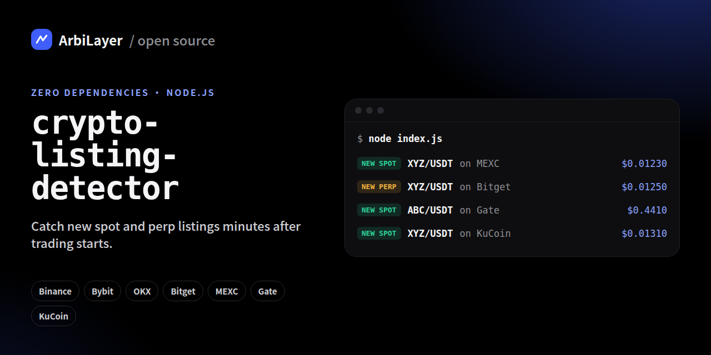

<p align="center"></p>

# crypto-listing-detector

Catch **new crypto listings** on Binance, Bybit, OKX, Bitget, MEXC, Gate and KuCoin, spot and perpetual futures, minutes after trading starts. It reads each exchange's public market list, diffs it against what it has seen before, and prints or sends every new market to Telegram or a webhook.

- **Zero dependencies.** Node.js 18+ and nothing else.
- **No API keys.** Only public endpoints.
- **No false alarms** from partial API responses, restarts or API changes (see [How it works](#how-it-works)).
- **Spot and perpetuals**, with the first traded price of every new market.

> Want all of this for **70+ exchanges**, with contract addresses, official listing announcements and a weekly listings report? It's free on **[ArbiLayer → New listings](https://arbilayer.com/listings)**, with alerts in the [Telegram channel](https://t.me/arbilayer).

## Quick start

```bash
git clone https://github.com/arbilayer/crypto-listing-detector.git
cd crypto-listing-detector
node index.js
```

The first pass saves a baseline of every market that exists today and reports nothing. From the next pass on, every new market is printed:

```
NEW SPOT  XYZ/USDT  on MEXC  first price $0.01230  (2026-10-10 16:26 UTC)
NEW PERP  XYZ/USDT  on Bitget  first price $0.01250  (2026-10-10 16:41 UTC)
```

## Options

| Flag | Default | What it does |
| --- | --- | --- |
| `--interval <min>` | `5` | Minutes between passes |
| `--exchanges <list>` | all | Comma-separated: `binance,bybit,okx,bitget,mexc,gate,kucoin` |
| `--once` | off | One pass and exit, for cron |
| `--state <file>` | `state.json` | Where seen markets are stored |

Run it from cron instead of keeping it open:

```bash
*/5 * * * * cd /path/to/crypto-listing-detector && node index.js --once >> listings.log 2>&1
```

## Telegram and webhook alerts

Copy `.env.example` to `.env` and fill in what you need:

```bash
TELEGRAM_BOT_TOKEN=123456:ABC...   # from @BotFather
TELEGRAM_CHAT_ID=123456789         # your chat id, or @yourchannel
WEBHOOK_URL=https://example.com/hook   # receives each listing as JSON
```

Then start it with the env file (Node 20.6+):

```bash
node --env-file=.env index.js
```

## How it works

Every exchange publishes the full list of its trading pairs. If a pair is in the list now and wasn't before, it's a new listing. That diff is about 20 lines of code. Three guards make it usable:

1. **Baseline.** The first read of an exchange would make all 1,500 of its markets look new. The first pass only records them; listings are reported from the second pass on. The state is saved to disk, so a restart doesn't re-trigger it.
2. **Partial responses.** APIs time out or return half a list. If a list is less than 80% of the size of the last good one, it's skipped, so the missing pairs don't come back as "new" next time.
3. **Bursts.** Real listings come one or two at a time. Dozens of "new" markets from one exchange in a single pass means the API changed, so that pass is recorded but not reported.

Symbols are normalised too: `1000PEPE`, `1000000MOG` and `1MBABYDOGE` count as the same coins as `PEPE`, `MOG` and `BABYDOGE`, and stablecoin quotes are preferred for the first price.

A longer write-up: [How we detect new crypto listings across 70+ exchanges](https://dev.to/arbilayer/how-we-detect-new-crypto-listings-across-70-exchanges-47p9).

## Same ticker, different token

Tickers are not unique. A new "XYZ" on one exchange can be a different token from "XYZ" on another. This tool reports markets, not contracts. **Always check the contract address on the exchange's deposit page before buying.** ArbiLayer's [listing pages](https://arbilayer.com/listings) match each listing to a contract by price and flag tickers shared by several coins.

## Adding an exchange

Add a function to `src/exchanges.js` that returns every market as `{ kind: 'spot' | 'perp', base, quote, price }`. Pull requests are welcome.

## More free tools from ArbiLayer

- [Crypto arbitrage scanner](https://arbilayer.com/arbitrage): live spreads between exchanges after fees, with contract checks
- [Funding rates](https://arbilayer.com/funding) and a [funding arbitrage calculator](https://arbilayer.com/tools/funding-arbitrage-calculator)
- [Weekly listings reports](https://arbilayer.com/listings/weekly)
- [Embeddable widgets](https://arbilayer.com/widgets) for your own site

## License

MIT. Not investment advice: new listings are among the most volatile markets in crypto.
